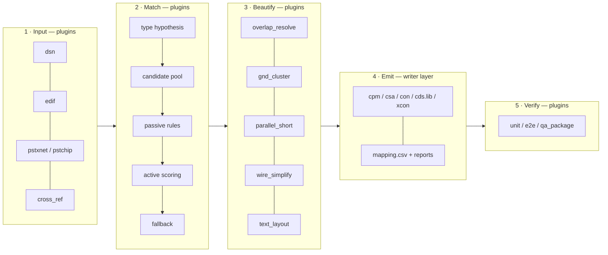

# CIS2HDL

**OrCAD Capture CIS → Cadence Design Entry HDL schematic converter.**

[](https://github.com/echoingme/CIS2HDL_plugin_ver/actions/workflows/ci.yml)
[](https://www.python.org/)
[](LICENSE)
[](tests/)
[](CHANGELOG.md)

CIS2HDL reads an OrCAD Capture CIS design, resolves every component against a Cadence
Design Entry HDL (Concept HDL) symbol library, lays the schematic out, and writes a
project that opens directly in Cadence SPB 16.6+. It is built as a five-stage,
plugin-composable pipeline so that each translation concern — parsing, matching,
layout beautification, file emission, verification — can be enabled, tuned or replaced
independently.

The project targets a concrete engineering bottleneck: migrating an existing CIS
schematic into the HDL flow is otherwise a manual, page-by-page re-entry job with heavy
symbol-matching and net-connectivity risk.

---

## Table of contents

- [What it does](#what-it-does)
- [Feature highlights](#feature-highlights)
- [Architecture](#architecture)
- [Installation](#installation)
- [Quick start](#quick-start)
- [Configuration](#configuration)
- [Command-line interface](#command-line-interface)
- [Repository layout](#repository-layout)
- [Testing and verification](#testing-and-verification)
- [Compatibility and limitations](#compatibility-and-limitations)
- [Documentation](#documentation)
- [Contributing](#contributing)
- [Citation](#citation)
- [License](#license)

---

## What it does

Two schematic databases, two file-format families, no bridge:

| Concept | OrCAD Capture CIS (source) | Cadence Design Entry HDL (target) |
|---|---|---|
| Design container | `.dsn` (OLE compound binary) | `.cpm` page + `.sch` sheets |
| Library cell | `.olb` package | `.sym` symbol + `.ptf` part table |
| Connectivity | DSN net table / EDIF netlist | wire geometry inside `.sch` |
| Project glue | `.opj` | `cds.lib`, `.cpm`, `.dcf`, `.xcon` |

CIS2HDL performs the structural translation end to end:

1. **Parse** the source design (binary DSN, EDIF netlist, PSTXNET/PSTCHIP side files, OLB library).
2. **Match** every component to a target HDL library cell, with manual override support.
3. **Lay out** the schematic — placement, wiring, off-page connectors, GND distribution, label placement.
4. **Emit** the complete HDL project, plus a mapping table and a diagnostic report.
5. **Verify** the result through built-in test suites and package checks.

## Feature highlights

**Parsing and input**
- Binary DSN reader for `.dsn` designs (OLE reader + binary record reader), with coordinates.
- EDIF netlist parser; PSTXNET netlist and PSTCHIP pin-name parsers; CrossRef CSV ingestion.
- OLB library parser covering 20/21 package types and 8 graphical element kinds.

**Component matching**
- Two-stage matcher: type hypothesis → candidate pool → per-class resolution.
- Passive components resolved by deterministic multi-level rules; active devices scored on
  five weighted dimensions (footprint 0.30, JEDEC 0.20, pin count 0.20, part name 0.15, value 0.15).
- Configurable thresholds (`exact 0.95 / fuzzy 0.75 / feature 0.60 / fallback 0.50`).
- Manual match table (`chip_config` YAML), forced mock symbols for mechanical parts,
  and export of unmatched components for offline triage.

**Layout and wiring**
- Three routing modes: `p0` (straight orthogonal), `detour` (obstacle-avoiding), `edif_reuse`
  (reuse wire segments carried by the EDIF netlist).
- Tunable geometry: lane pitch, grid, stub lead length, edge clearance, non-uniform tracks,
  net ordering (`short_first` / `long_first`).
- Beautification passes: overlap resolution, GND clustering, parallel-net shortening,
  wire simplification, three-stage stubs, label/text de-confliction.
- Off-page connector edge layout, per-chip GND distribution, and an IOPORT consistency audit.

**Output** — a complete Cadence Project Manager tree, not just the schematic files:

```
output_root/
├── <cell>.cpm            # Project Manager file
├── cds.lib               # library definitions
├── temp/
└── worklib/<cell>/sch_1/
    ├── page1.csa …       # native CSA page files (MACRO_DRAWING)
    ├── <cell>.con        # constraint file
    ├── module_order.dat  # module order list
    ├── master.tag
    └── page.map
```

Alongside it: `mapping.csv` (matched / unmatched table), an error log (HTML + TXT), and
aesthetic and IOPORT audit reports. Diagnostics are produced in six stages with 44 error
codes: file integrity → dependency resolution → readiness → matching → validation → quality.

**Engineering**
- Plugin architecture built on [pluggy](https://pluggy.readthedocs.io/): 7 hook specifications,
  20 plugin implementations across the `input`, `match`, `beautify` and `test` stages,
  per-plugin declared write-sets with a read-only `ConversionContext` guard.
- Declarative `pipeline.yaml` as the single source of configuration, with switchable profiles
  (`default`, `fast`, `max-beauty`, `match-only`) and user profiles that can be created,
  exported and imported.
- 1,042 automated tests run and pass in a clean checkout (222 more exercise third-party
  design data that is not redistributed, and skip without it).
- PySide6 GUI (its own entry point) over the same conversion engine as the CLI.

## Architecture



Every stage is driven by plugins registered against a shared `ConversionContext`; the
ordered stages (`load_input`, `match_components`, `beautify`) execute in the exact order
declared in `pipeline.yaml`. A stage with an empty plugin list is a no-op, and the engine's
built-in implementation remains the fallback for any hook that returns "not handled" —
which is what makes profile-level equivalence testing possible.

## Installation

Requires **Python 3.12+**. The converter itself is pure Python; a Cadence installation is only
needed to *open* the generated project.

```bash
git clone https://github.com/echoingme/CIS2HDL_plugin_ver.git
cd CIS2HDL_plugin_ver
python -m venv .venv
source .venv/bin/activate        # Windows: .venv\Scripts\activate
pip install -e ".[dev]"
```

Minimal runtime dependencies: `pydantic`, `sexpdata`, `pyyaml`, `rapidfuzz`, `pluggy`,
`pyside6` (GUI only). `requirements.txt` mirrors the same set for non-PEP-517 setups.

## Quick start

Convert an EDIF netlist with the default profile:

```bash
cis2hdl convert board.EDF --output out/ --hdl-lib /path/to/hdl_library
```

Convert a binary DSN design with the aggressive beautification profile:

```bash
cis2hdl convert board.DSN --profile max-beauty --output out/ \
    --hdl-lib /path/to/hdl_library --pipeline pipeline.yaml
```

Launch the GUI (profile bar, stage tabs, plugin toggles, YAML editor, conversion runner,
report view, manual-match panel):

```bash
cis2hdl gui
```

Run the verification suites:

```bash
cis2hdl verify --suite unit --suite e2e
```

Inspect and manage configuration profiles:

```bash
cis2hdl profile list
cis2hdl profile show max-beauty
cis2hdl profile export max-beauty -o my-profile.yaml
```

## Configuration

`pipeline.yaml` is authoritative. Precedence is: **`pipeline.yaml` → `--profile` → path-level
CLI flags** (`--output`, `--hdl-lib`, `--extra-hdl-lib`).

```yaml
schema_version: 1
profile: default

input:
  hdl_lib: ""                 # primary HDL symbol library
  extra_hdl_libs: []
  plugins: [edif, pstxnet, pstchip]

match:
  plugins: [exact, fuzzy, passive, fallback]
  weights: {footprint: 0.30, value: 0.15, jedec: 0.20, pin_count: 0.20, part_name: 0.15}
  thresholds: {exact: 0.95, fuzzy: 0.75, feature: 0.60, fallback: 0.50}

beautify:
  plugins: [overlap_resolve, gnd_cluster, parallel_short]
  params:
    routing: {mode: p0, lane_pitch: 50, grid: 25, stub_lead: 100}

output:
  files:   [csa, con, xcon, csv, cpc, cpm, cds_lib]
  reports: [aesthetic, ioport, mapping, error]

test:
  suites: [unit, e2e, qa_package]

engine:
  output_dir: output
  max_workers: 4
```

Built-in profiles:

| Profile | Intent |
|---|---|
| `default` | Byte-equivalent to the validated baseline behaviour |
| `fast` | Skips report writing and test suites for quick iteration |
| `match-only` | Matching stage only — exports `mapping.csv`, emits no schematic |
| `max-beauty` | `detour` routing plus wire simplification, three-stage stubs and text layout |

## Command-line interface

```
cis2hdl convert <input> [--output DIR] [--hdl-lib DIR] [--extra-hdl-lib DIR]
                        [--pipeline FILE] [--profile NAME]
cis2hdl verify  [--suite unit|e2e|qa_package] [--pipeline FILE] [--profile NAME]
cis2hdl profile list|show|create|export|import
cis2hdl gui
```

Exit codes: `0` success, `1` conversion or runtime failure, `2` configuration/usage error.
Flags removed in the YAML migration now fail with an explicit pointer to the corresponding
`pipeline.yaml` field — see [docs/cli-migration.md](docs/cli-migration.md).

## Repository layout

```
cis2hdl/
├── cis2hdl/
│   ├── cli.py              # command-line front end
│   ├── verify.py           # verification runner
│   ├── config/             # bundled YAML configuration fragments
│   ├── core/
│   │   ├── parser/         # dsn · olb · edif · pstxnet · pstchip · cross_ref · symbol
│   │   ├── matcher/        # type hypothesis · candidate pool · passive · active scoring
│   │   ├── writer/         # cpm · sch · csa · con · dcf · xcon · router · wire layout
│   │   ├── diagnostics/    # six-stage diagnostics, 44 error codes
│   │   ├── validator/      # net · pin · power validation
│   │   ├── engine/         # conversion and batch engines
│   │   └── ir/             # design · component · match intermediate representation
│   ├── plugins/            # input · match · beautify · output · test plugin implementations
│   └── gui/                # PySide6 application
├── profiles/               # built-in read-only profiles
├── tests/                  # unit · integration · e2e · archived legacy tests
├── scripts/                # benchmark, packaging and verification helpers
├── docs/                   # architecture, matching, plugin API, developer and GUI guides
└── pipeline.yaml           # authoritative configuration
```

## Testing and verification

```bash
pytest                        # 1,042 pass, 222 skip in a clean checkout
pytest tests/unit -q          # unit only
ruff check cis2hdl            # lint (E,F,W,I,N,UP,B,C4,SIM; line length 100)
mypy cis2hdl                  # strict type checking
```

Lint and strict typing are configured but not yet enforced repository-wide: the tree is being
migrated rule by rule, so new and modified code is expected to be clean while older modules
may still report findings.

The suite is organised in four layers: `tests/unit` (module-level behaviour),
`tests/integration` (cross-module pipelines), `tests/e2e` (real designs and byte-level
comparison against reference output) and the `qa_package` suite (structural checks on a
produced delivery directory). **No design data is redistributed.** The projects, netlists and symbol libraries used for
development belong to third parties, so `tests/fixtures/` is empty in a clean clone: tests
that measure real conversions skip, and the parser, matcher, writer and plugin layers are
exercised against synthetic frames and programmatic models instead. `tests/fixtures/` is
git-ignored, so a local copy cannot be committed by accident.

CI runs the unit layer and a configuration check on every push — Linux, Python 3.12
([workflow](.github/workflows/ci.yml)). The end-to-end layer works on complete reference
designs and is run locally:

```bash
pytest tests/e2e -q
```

## Compatibility and limitations

- **Python 3.12+.** Developed and validated primarily on Windows, where the Cadence
  environment lives; the converter runs cross-platform, but path defaults assume Windows.
- **Cadence SPB 16.6+** is required to open the generated project. Output compatibility was
  validated against SPB 16.6 by opening converted projects and comparing page/primitive
  counts with the CIS original.
- DSN binary coverage depends on the Capture version that produced the file; unsupported
  records are reported as diagnostics rather than silently dropped.
- The GUI requires `pyside6`; the CLI and the plugin pipeline run headless.

## Documentation

| Document | Contents |
|---|---|
| [docs/ARCHITECTURE.md](docs/ARCHITECTURE.md) | System architecture, backend design, device model, diagnostics, GUI design |
| [docs/MATCHING.md](docs/MATCHING.md) | Matching system: failure analysis, two-stage design, class and sequence diagrams |
| [docs/plugin-api.md](docs/plugin-api.md) | Plugin contract: hooks, `ConversionContext`, `PluginSpec`, registration |
| [docs/developer-guide.md](docs/developer-guide.md) | Stage-by-stage developer guide and extension recipes |
| [docs/gui-design.md](docs/gui-design.md) | GUI structure, component tree, interface signatures, data flow |
| [docs/STANDARDS.md](docs/STANDARDS.md) | Coding standards, development process, schematic conventions |
| [docs/VERIFICATION_GUIDE.md](docs/VERIFICATION_GUIDE.md) | How to verify a conversion against a reference design |
| [docs/S1-config-design.md](docs/S1-config-design.md) · [docs/S2-plugin-base-design.md](docs/S2-plugin-base-design.md) | Configuration-layer and plugin-foundation design records |
| [CHANGELOG.md](CHANGELOG.md) | Version history |

## Contributing

Issues and pull requests are welcome. Please read [CONTRIBUTING.md](CONTRIBUTING.md) first —
it covers the development loop, coding standards and the verification that a change is
expected to pass.

## Citation

If you reference this tool in academic work, see [CITATION.cff](CITATION.cff).

## Related

- **[cis2hdl_dsn_ver](https://github.com/echoingme/cis2hdl_dsn_ver)** — the DSN-driven line of
  the converter: binary DSN as the single source of truth, six-way match routing, golden
  comparison against reference exports. This repository is the upstream plugin-architecture
  line.

## License

Released under the [MIT License](LICENSE). © 2026 Zhichen Rao.
